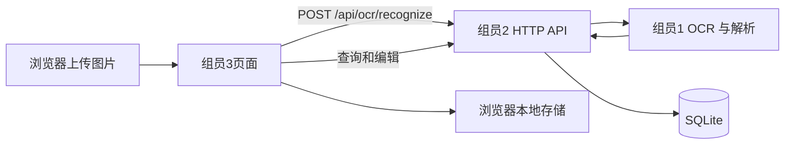

# 架构与数据流

应用由原生 HTML/CSS/JavaScript 页面、Python 标准库 HTTP 服务、SQLite 数据库以及独立 OCR 和菜单解析模块组成。无需 Node 构建。三个模块通过同级目录约定连接：后端提供静态页面和 `/api/*`，动态加载 OCR 模块，页面向同源服务发请求。

浏览器本地样例与持久化数据库数据并不完全等价；离线及同步失败的操作需要单独验证。原 Demo 是 UI 原型，组员 3 页面在其基础上继续开发并增加后端接入，不应覆盖最新页面。API 详见 `模块划分版本/组员2_后端接口/API.md`。
