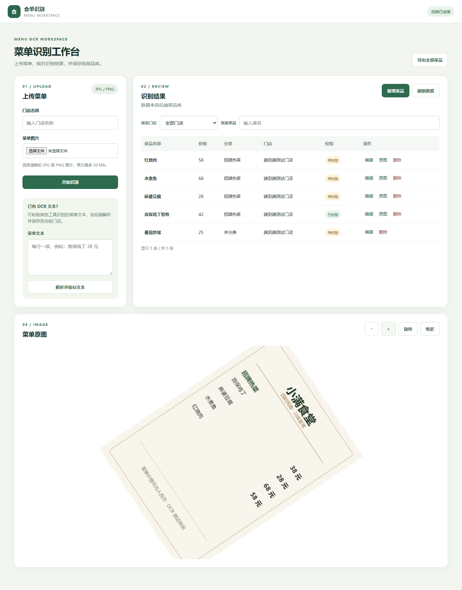

# 菜单 OCR 系统整合与测试报告

## 1. 项目概述

食单识别是一套本地菜单 OCR 与菜品管理应用。用户上传图片或输入外部 OCR 文本，后端完成识别、解析与 SQLite 存储，用户核对并编辑、手工新增、查询、删除及导出。系统沿用 Python 标准库 HTTP、原生 HTML/CSS/JavaScript、SQLite、Windows OCR / RapidOCR，不引入新业务框架。

## 2. 原始代码结构与问题

原始 `ocr-menu-demo/` 是带样例、校验和导出的静态原型；组员 1 模块负责图片识别和解析；组员 2 模块提供 API、SQLite、导出；组员 3 模块在 Demo 上增加后端调用。三者已有部分接口衔接，但早期前端仍混用演示数据、本地存储与后端数据，保存失败也先修改本地状态；后端按扩展名接受部分伪造图片，旧数据库将上传图片记录为绝对路径。四套目录简单复制不足以证明统一的数据流与持久化。

## 3. 完整项目架构

```text
complete-project/
├── start.py             统一入口
├── web/                 唯一正式界面
├── backend/             HTTP API、SQLite、上传与导出
├── ocr/                 OCR 引擎、解析、真实样例
└── tests/               单元、接口和浏览器端到端测试
```

浏览器上传 → `POST /api/ocr/recognize` → 图片类型校验 → OCR → 菜单结构化解析 → SQLite → 页面通过 `GET /api/dishes` 读取。编辑使用 `PUT /api/dishes/{id}`，新增使用 `POST /api/dishes`，删除使用 `DELETE /api/dishes/{id}`，导出使用 `GET /api/dishes/export`；外部文本通过 `POST /api/ocr/results` 解析并入库。页面刷新重新从后端取数，不再把演示数据或浏览器本地状态当成数据库。数据默认位于完整项目 `backend/data/`，图片以相对文件名记录，旧绝对路径仅在仍属于上传目录时兼容。

## 4. 实际整合和修复

保留原始项目目录与当前 master 一致；仅重组 `complete-project/` 内的副本。原 Demo 的上传、校验、菜品查询与导出流程被吸收到唯一 Web 界面，不再维护独立 Demo 页面及第二套浏览器 XLSX 构造器。复用现有 OCR/解析、API、SQLite 和后端 XLSX 导出，调整目录与配置，统一数据来源；支持原图查看、门店筛选、文本导入、手工新增及疑似重复提示。

修复了非图片仅凭扩展名通过初步校验，以及保存失败后界面仍显示未确认的本地修改。OCR 无文字时返回失败；错误由界面显示。接口在菜品列表增加 `has_image` 标识，避免外部 OCR 文本记录展示不存在的原图。支持同门店同名同价的疑似重复合并，合并删除当前记录且不转移图片关联；支持原图缩放和旋转查看。旧原型的浏览器离线演示没有移植。

## 5. 风险与问题

对应「第06组-项目Task表」的 Bug 与改进表。

状态为「待处理 / 处理中 / 待复测」的条目请在此同步。

| 问题编号 | 类型 | 标题 | 优先级 | 状态 |
| ---- | -- | -- | --- | -- |
| 无 | 无 | 无 | 无 | 无 |

BUG-001～004 已完成代码修复及对应自动复测；学校在线问题表尚未同步，人员及学校状态选项待确认。Windows 中文 OCR 已实测，RapidOCR、其他系统和干净机器依赖安装尚未验证。应用仅面向本机演示，未提供用户认证。

## 6. Git/Gitee 协作

Gitee 仓库为 https://gitee.com/JinchengNie/fail-the-accounting-course ，开发使用 `czh`。PR !11 原有的原始文件回退由新提交修正；本次集成提交 `9d7a7b9` 后还有文本导入、验证和报告更新。原始目录的最终差异在推送前需再次核对。

## 7. PR 与审核

[PR !11](https://gitee.com/JinchengNie/fail-the-accounting-course/pulls/11) 为 `czh` → `master`，上次检查时为开启、待审核；实际推送后的状态以 Gitee 页面为准。不自动合并，不声称已审批。

## 8. 测试与验收

在 Windows / Python 3.12 环境中，独立复制的项目运行 8 项 OCR、API、集成及异常测试通过；`reports/evidence/formal-isolated-tests.log` 保留命令与结果。浏览器实际从统一入口上传真实样例，返回 4 道菜；编辑后保存、刷新和 API 查询确认价格持久化；原图、旋转缩放、Excel 内容、删除后刷新、手工新增、重复合并、外部文本、伪造图片错误均通过。OCR 422 与保存 500 的前端提示使用请求拦截模拟服务失败，非真实 OCR 故障；真实 OCR 成功链路未模拟。完整结果见 `evidence/formal-e2e.log`。浏览器曾因测试辅助进程管道阻塞出现超时，改用服务输出重定向后完整流程通过。

追加回归：9 项自动测试通过；真实 SQLite 的 2001 条记录通过接口、XLSX 导出及浏览器加载、搜索和刷新验证，见 `evidence/bug-004-pagination.log`。完整浏览器 OCR 流程重新通过。

## 9. 实际运行截图



图为浏览器自动化实际上传、识别并编辑保存后的页面；并非合成截图。

## 10. 总结与后续改进

正式界面、HTTP API、OCR 和数据库已形成实测闭环。后续可增加用户认证、跨平台 OCR 和新机器部署验证，完善按批次操作及重复合并后的图片来源记录，完成学校在线表格同步和组员审批。2026-11-17 的 2001 条回归已验证列表、导出及分页；浏览器加载全部数据，超大数据量性能及并发增删时分页快照一致性仍需改进。
